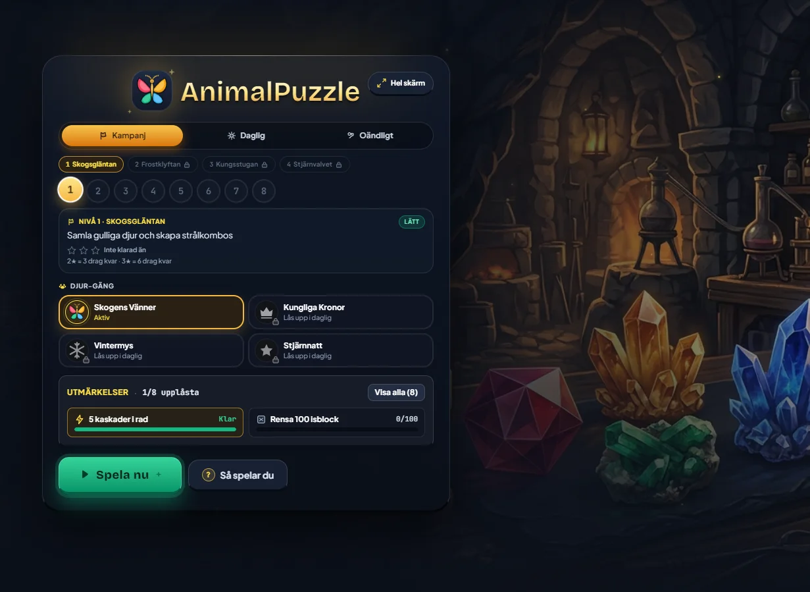
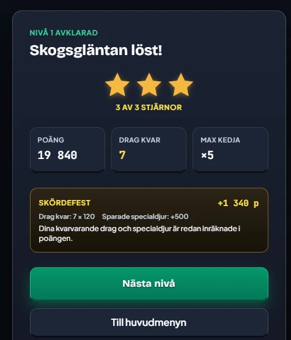

<div align="center">


<h1>AnimalPuzzle</h1>

**A tactical crystal puzzle. Unreasonably cute animals.**

Match forest friends, build cascades, and ignite prism reactions in a dark
Nordic crystal workshop. Every move can start a chain reaction — and every
cascade can become a small legend.

<br />


</div>

<p align="center">
  
</p>

## More than a match-3

AnimalPuzzle is a match-3 game where every gem is also a tiny creature. Swap
adjacent animals, build long chains, and use special pieces to break through
frost, chains and wooden crates.

The game is designed to be easy to pick up but hard to put down: short moves,
clear goals, and a reward loop that feels just as good on mobile as on desktop.
The interface is available in Swedish, English, German, Spanish, French and Turkish and follows your browser
language — you can switch at any time in the settings.

<table>
  <tr>
    <td width="50%" valign="top">
      <h3>🐾 Twelve animals, twelve colors</h3>
      <p>The fox, the panda, the dolphin and the rest have their own personalities — and their own little faces that make every match easy to read.</p>
    </td>
    <td width="50%" valign="top">
      <h3>✨ Cascades that keep building</h3>
      <p>Matches of four, L-shapes and T-shapes create Beams, Novas and Prisms. Combine them for Crossbeams, Supernovas and Prismstorms.</p>
    </td>
  </tr>
  <tr>
    <td valign="top">
      <h3>🏆 3,000 chapters, 24,000 levels</h3>
      <p>From Skogsgläntan to Stjärnvalvet. Every level has its own objectives, star requirements and a clear difficulty curve.</p>
    </td>
    <td valign="top">
      <h3>📅 Something new every day</h3>
      <p>Daily challenges with a date-locked board, bonus energy and exclusive skins. Endless mode is there for anyone chasing one more record.</p>
    </td>
  </tr>
  <tr>
    <td valign="top">
      <h3>🛠️ Tools with a purpose</h3>
      <p>Hammer, Cross Pulse and Shuffle charge through cascades. Use them when the board is stuck — not as a shortcut around the game.</p>
    </td>
    <td valign="top">
      <h3>📱 Play anywhere</h3>
      <p>Responsive layout, touch and mouse controls, fullscreen, haptics and a real offline PWA. Your current game is saved after every move, so you can always continue where you left off.</p>
    </td>
  </tr>
</table>

## From board to victory

<table>
  <tr>
    <td width="62%" align="center" valign="top">
      
      <br />
      <sub><strong>Eight by eight</strong> · match, chain and read the board</sub>
    </td>
    <td width="38%" align="center" valign="top">
      
      <br />
      <sub><strong>Three out of three</strong> · score, moves left and Harvest bonus</sub>
    </td>
  </tr>
</table>

## Game modes

| Mode | What awaits |
| :--- | :--- |
| **Campaign** | 24,000 levels in 3,000 chapters: 32 handcrafted levels to start, then levels generated deterministically from the level number. Complete the objectives before your moves run out and collect stars for better rewards. |
| **Daily Challenge** | A new, date-locked challenge every day. Complete it for bonus energy and a chance at exclusive animal skins. |
| **Endless** | No level objectives — just you, the board, and the hunt for your next personal best. |
| **Time mode** | 60 seconds on the clock and no move limit. Your best rounds of the week go on a weekly list that starts over every Monday. |
| **Weekly special level** | One extra hard level that stays the same all week, found under the daily challenge. The first win of the week pays 100 bonus energy. |

## A world of its own

- **Companions** – bring one animal along. Its power charges from the animals you clear and costs no move; each of the twelve animals has a power of its own, and animals level up as you collect them.
- **A story** – short comic pages tell how the animals were scattered by a storm and travel through six landscapes to gather the pack.
- **A boss per landscape** – Captain Kraken, the Wasp Queen, the Sandworm, the Ice Dragon, Captain Blip and the Lava Dragon each fight back in their own way.
- **Your island** – spend the stars you win on twelve buildings and rebuild the animals' home.
- **Daily missions** – three small goals every day that pay bonus energy.
- **Statistics** – time played, favourite animal, longest chain and more.

What is new around the journey:

- **Bosses with two phases** — every boss has a health bar, and at half health it becomes enraged and attacks one move sooner.
- **A page after every boss** — beating a chapter boss for the first time shows a short story scene.
- **Stronger powers** — a companion's power grows at level 5 and again at level 10.
- **A living island** — one animal moves into every building, and the islanders hand over a small gift of bonus energy once a day.
- **Animal voices** — every companion has its own sound when its power fires, and bosses growl when they attack.

## Getting started

**Requires:** [Bun](https://bun.sh) 1.x

```bash
git clone https://github.com/nRn-World/AnimalPuzzle.git
cd AnimalPuzzle
bun install
bun run dev
```

Open [http://localhost:3000](http://localhost:3000). No API keys or external
services are required.

Build a production version:

```bash
bun run build
bun run preview
```

## How to play

1. **Swap two adjacent animals** to create a match.
2. **Match four or more** to create a Beam. L- and T-shapes create a Nova, and
   even larger combinations can create a Prism.
3. **Combine special pieces** for more powerful reactions — but keep an eye on
   the objectives. Frost, chains and wooden crates each need a different
   approach.
4. **Charge your tools** by chaining matches. Hammer breaks one tile, Cross
   Pulse clears a row and column, and Shuffle rearranges the board.

## Under the hood

| Part | Technology |
| :--- | :--- |
| Interface | React 19 + TypeScript |
| Build | Vite 8 + Tailwind CSS 4 |
| Game engine | Plain TypeScript in `src/game` |
| Effects | Canvas and Web Audio (generated sound effects and music, no audio files) |
| Quality | `bun test` + `tsc --noEmit` |
| Installation | PWA manifest + service worker (works offline), self-hosted fonts |
| Language | Swedish, English, German, Spanish, French and Turkish (`src/i18n`) |

```text
src/
├─ components/     Board, HUD, modals, settings and guides
├─ game/           Engine, levels, daily challenges, saves, audio and tests
├─ hooks/          useGameSession (the game flow), settings, board size
├─ i18n/           Swedish source strings + one dictionary per language
├─ assets/         Backgrounds and artwork
└─ App.tsx         Thin shell that wires the pieces together
tools/             Vite plugin that generates the service worker
public/
├─ manifest.webmanifest
├─ icon-192.png
├─ icon-512.png
└─ favicon.svg
docs/screenshots/  Images used by this README
```

## Quality

The project has **58 tests across 14 files**, covering the engine, levels,
scoring, saved games, storage migration, sharing, translations, daily records,
achievements and tutorial limits. The same three commands run in CI before
every deploy and on every pull request.

```bash
bun test        # 58 tests
bun run lint    # TypeScript check
bun run build   # production build
```

## Settings and accessibility

Open the gear icon in the menu or the pause screen:

- **Sound** — mute, plus separate volume for sound effects and music. Audio
  pauses automatically when the tab is hidden.
- **Vibration** — short haptic feedback on supported phones.
- **Reduced motion** — turns off shake, tilt and menu animations (the system
  setting is always respected).
- **Symbols on the animals** — a unique shape per animal, so color is never the
  only cue.
- **Language** — Swedish, English, German, Spanish, French or Turkish.
- **Reminders** — an optional notification when your lives are full again. It works while the game is still open in the background, for example as an installed app.

Pinch-zoom is enabled. Adding a language means adding one dictionary next to
`src/i18n/en.ts`; a test fails if any string is missing.

## Install as an app

AnimalPuzzle can be added to your home screen. Open the game in a modern
browser and choose **Install** or **Add to Home Screen**. Android uses the
192px and 512px manifest icons; iOS uses the Apple touch icon. Once it has
been opened online, the game also works without a connection.

## Credits

The menus use a comic-book look built in plain CSS. Icons are from
[Kenney](https://www.kenney.nl)'s *Game Icons* (CC0), see
`src/assets/ui/LICENSE.txt`. Fonts are *Bangers* and *Grandstander*
(SIL Open Font License), bundled through Fontsource.

## License

This project is licensed under the [MIT License](LICENSE).

© 2026 nRn-World
