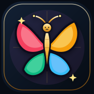
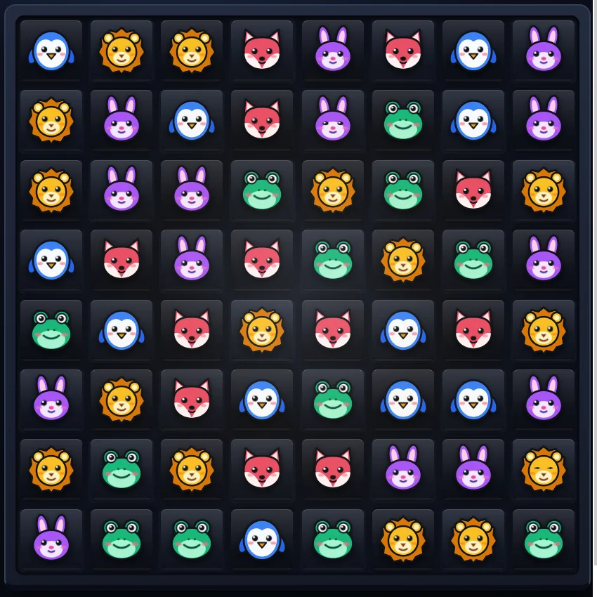

<div align="center">



<h1>AnimalPuzzle</h1>

**Taktiskt kristallpussel. Ovanligt söta djur.**

Matcha skogens vänner, bygg kedjereaktioner och tänd prismareaktioner i en mörk,
nordisk kristallverkstad. Varje drag kan bli början på en kaskad — och varje
kaskad kan bli en liten legend.

<br />


</div>

<p align="center">
  
</p>

## Ett pussel med bett

AnimalPuzzle är ett match-3-spel där varje ädelsten också är en liten varelse.
Byt plats på intilliggande djur, bygg långa kedjor och använd specialare för att
ta dig igenom frost, kedjor och trälådor.

Spelet är byggt för att vara lätt att börja med men svårt att släppa: korta drag,
tydliga mål och en belöningsloop som känns lika bra på mobilen som på skrivbordet.

<table>
  <tr>
    <td width="50%" valign="top">
      <h3>🐾 Tolv djur, tolv färger</h3>
      <p>Räven, pandan, delfinen och de andra har egna personligheter — och egna små ansikten som gör varje matchning lätt att läsa.</p>
    </td>
    <td width="50%" valign="top">
      <h3>✨ Kaskader som bygger vidare</h3>
      <p>Fyra i rad, L-former och T-former skapar Strålar, Novor och Prisman. Kombinera dem för Crossbeam, Supernova och Prismstorm.</p>
    </td>
  </tr>
  <tr>
    <td valign="top">
      <h3>🏆 Fyra kapitel, 32 nivåer</h3>
      <p>Från Skogsgläntan till Stjärnvalvet. Varje nivå har egna mål, stjärnkrav och en tydlig svårighetskurva.</p>
    </td>
    <td valign="top">
      <h3>📅 Något nytt varje dag</h3>
      <p>Dagliga utmaningar med datumlåst bräda, bonusenergi och exklusiva skinn. Oändligt läge finns för den som bara vill jaga ett till rekord.</p>
    </td>
  </tr>
  <tr>
    <td valign="top">
      <h3>🛠️ Verktyg med avsikt</h3>
      <p>Hammare, Korspuls och Blanda laddas av kaskader. Använd dem när brädet sitter fast — inte som en genväg förbi spelet.</p>
    </td>
    <td valign="top">
      <h3>📱 Spela var du vill</h3>
      <p>Responsiv layout, touch- och musstyrning, helskärm och PWA-stöd med Prismafjärilen på hemskärmen.</p>
    </td>
  </tr>
</table>

## Från bräda till seger

<table>
  <tr>
    <td width="62%" align="center" valign="top">
      
      <br />
      <sub><strong>Åtta gånger åtta</strong> · matcha, kedja och läs brädet</sub>
    </td>
    <td width="38%" align="center" valign="top">
      
      <br />
      <sub><strong>Tre av tre</strong> · poäng, drag kvar och Skördefest</sub>
    </td>
  </tr>
</table>

## Spellägen

| Läge | Vad som väntar |
| :--- | :--- |
| **Kampanj** | 32 handbyggda nivåer över fyra kapitel. Klara målen innan dragen tar slut och samla stjärnor för bättre belöningar. |
| **Daglig utmaning** | En ny, datumlåst utmaning varje dag. Klara den för bonusenergi och en chans på exklusiva djur-skinn. |
| **Oändligt** | Inga nivåmål — bara du, brädet och jakten på nästa personliga rekord. |

## Kom igång

**Krav:** [Bun](https://bun.sh) 1.x

```bash
git clone https://github.com/nRn-World/AnimalPuzzle.git
cd AnimalPuzzle
bun install
bun run dev
```

Öppna [http://localhost:3000](http://localhost:3000). Inga API-nycklar eller
externa tjänster behövs.

Bygg en produktionsversion:

```bash
bun run build
bun run preview
```

## Så spelar du

1. **Byt plats** på två intilliggande djur för att skapa en matchning.
2. **Matcha fyra eller fler** för att skapa en Stråle. L- och T-former ger en
   Nova, och ännu större kombinationer kan ge ett Prisma.
3. **Kombinera specialare** för kraftfullare reaktioner — men håll koll på målen.
   Frost, kedjor och trälådor kräver olika angreppssätt.
4. **Ladda verktygen** genom att kedja matcher. Hammare spräcker en ruta,
   Korspuls rensar en rad och kolumn, och Blanda lägger om brädet.

## Under huven

| Del | Teknik |
| :--- | :--- |
| Gränssnitt | React 19 + TypeScript |
| Bygge | Vite 8 + Tailwind CSS 4 |
| Spelmotor | Ren TypeScript i `src/game` |
| Effekter | Canvas, Web Audio och Three.js |
| Kvalitet | `bun test` + `tsc --noEmit` |
| Installation | PWA-manifest med 192- och 512-ikoner |

```text
src/
├─ components/     Spelbräda, HUD, modaler och guider
├─ game/           Motor, nivåer, dagliga utmaningar och tester
├─ assets/         Bakgrund och grafik
└─ App.tsx         Spellfaser och state
public/
├─ manifest.webmanifest
├─ icon-192.png
├─ icon-512.png
└─ favicon.svg
docs/screenshots/  Bilder till README
```

## Kvalitet

Projektet har **34 tester i 8 filer** som täcker bland annat motorn, nivåer,
dagliga rekord, achievements och tutorialgränser.

```bash
bun test        # 34 tester
bun run lint    # TypeScript-kontroll
bun run build   # produktionsbygge
```

## Installera som app

AnimalPuzzle kan läggas till på hemskärmen. Öppna spelet i en modern webbläsare
och välj **Installera** eller **Lägg till på hemskärmen**. Android använder
manifestets 192- och 512-ikoner; iOS använder apple-touch-ikonen.

## License

This project is licensed under the [MIT License](LICENSE).

© 2026 nRn-World
